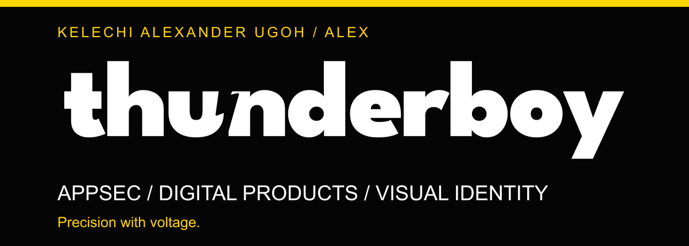
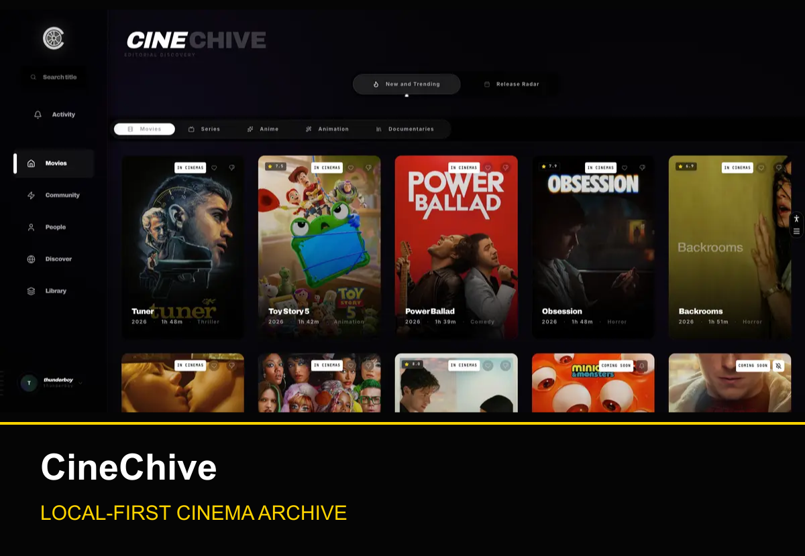
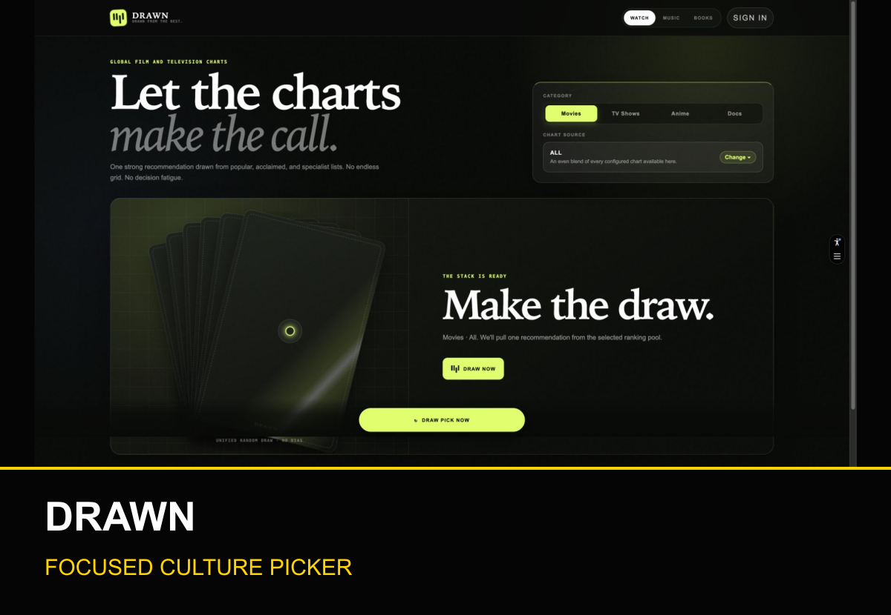
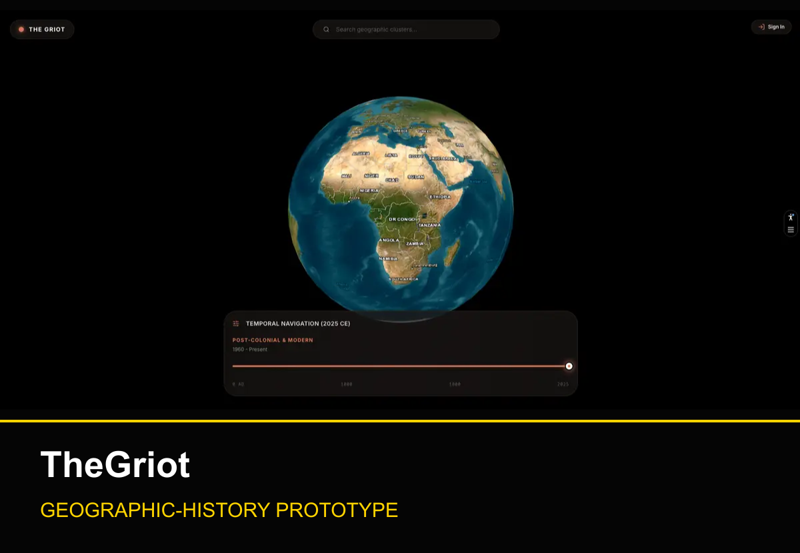

# Alex — Kelechi Alexander Ugoh

### AppSec, digital products, visual identity & code.

I'm **Alex (Kelechi Alexander Ugoh)**, a cybersecurity analyst focused on application security (AppSec). I build digital products and visual identities as **Thunderboy**, and continue my cybersecurity studies through practical labs and projects.

[Portfolio](https://thunderboy.vercel.app) · [Contact](https://thunderboy.vercel.app/contact)

## Learning, skills & tools

- Application security (AppSec), connected to my product-development background
- Practical networking: IPv4 addressing, DHCP, routing and selective ACL testing
- Cisco Packet Tracer for educational network labs
- React, Next.js, TypeScript and Tailwind CSS for digital products

**Goal:** deepen my AppSec practice and publish projects with useful evidence and clear limits.

## Selected work

**CineChive:** discovery, a personal library, journal and JSON backup/import. Personal records stay in the browser by default.

**DRAWN:** films, music and books from ranking sources, with browser-local saved collections. CI is blocked by an account billing lock.

**TheGriot:** geographic history and different narratives. The tracked prototype migration disables RLS; this is not a production authorization design.

Project images are existing portfolio captures verified 8 October 2026, not evidence of current uptime or completed validation.

More work: [AlienMint](https://github.com/Alexthethunderboy/alienmint), [Dumami Hair](https://github.com/Alexthethunderboy/dumamihair), and [DirDeo](https://github.com/Alexthethunderboy/dirdeo). Explore the projects and their scope on [my portfolio](https://thunderboy.vercel.app/projects).

## Cybersecurity learning & projects

**[NetCore — DHCP, routing and selective traffic filtering](https://github.com/Alexthethunderboy/netcore-network-lab).** Educational Cisco Packet Tracer coursework modelling IT, Sales and HR across three /24 networks. Router-based DHCP supplies six PCs; an inbound Sales ACL blocks Sales-originated ICMP echo requests to IT while preserving replies for IT-initiated pings. Recorded live tests on 9 October 2026 matched ten expected traffic outcomes, including HTTP and FTP. Reopening and retesting the saved project remains unverified. These unencrypted lab services and permissive ACL are not a production-security design. The repository contains the original case study and two reviewed lab captures.

